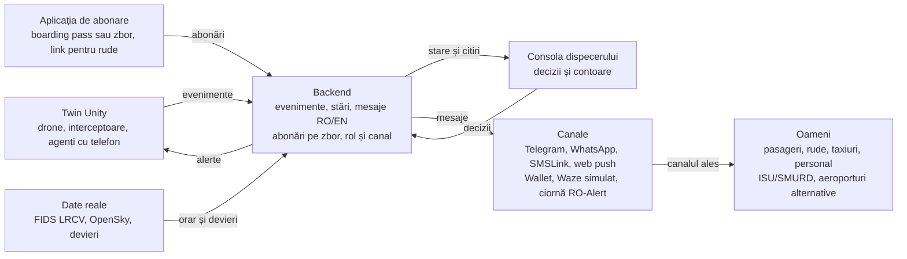

# Clarion: Airport Crisis Orchestration (CONTROL TOWER)

CONTROL TOWER coordonează informarea când Aeroportul Craiova oprește zborurile.  
Dispecerul confirmă incidentul și aprobă mesaje pentru pasageri, rude, taxiuri și echipele de intervenție.  
Twin-ul Unity compară scenarii cu și fără alerte; consola coordonează revenirea.

Ținta este notificarea în primul minut de la confirmare. Nu promitem acoperire totală sau citire în primul minut. Detecția rămâne internă. O pistă închisă nu înseamnă terminal închis. Statusul zborului aparține companiei aeriene. [Plan, p. 1-5](app/PM/control-tower-plan.pdf#page=1)

## Documente

- `docs/ROLURI.md`: cine ce face până duminică la 15:00
- `app/PM/SPEC.md`: specul v3 (Clarion), `app/PM/CONTRACT.md`: contractul Unity / consolă / backend
- `docs/research/`: rapoartele de cercetare (impact, anti-dronă, canale de notificare, date de simulare)
- `docs/simulare-agenti-ai.md`: cum decid oamenii din simulare
- `whatsapp/`: template-urile WhatsApp și scriptul care le validează și le trimite la Meta
- `bogdan-research/`: sinteza cercetării și rapoartele deep research

## Arhitectura

Cele 7 componente și cele 8 legături din [plan, p. 9](app/PM/control-tower-plan.pdf#page=9):



Twin-ul și telefoanele primesc alerte din același backend. RO-Alert este doar o ciornă pentru ISU. Feed-ul Waze este simulat. [Plan, p. 9-10](app/PM/control-tower-plan.pdf#page=9)

## Structura repo-ului

| Cale | Conținut |
|---|---|
| `app/` | Consola dispecerului la `/`; abonare la `/join`; QR la `/join/qr`. |
| `backend/` | Server HTTP/WebSocket, stări, mesaje și canale. |
| `sim-ab/` | Rulări A/B fără interfață. Rezultatele nu înlocuiesc validarea twin-ului. |
| Branch-ul lui Marius | Twin-ul Unity. Numele branch-ului se confirmă cu Marius. |
| `app/PM/` | Planul echipei, SPEC și CONTRACT. |
| `docs/pitch/` | Discursuri, slide-uri, întrebări și checklist. |
| `bogdan-research/README.md` | Sinteza cercetării și planuri ulterioare. |
| `bogdan-research/chatgpt/` | Rapoarte de cercetare ChatGPT în română. |
| `bogdan-research/codex/` | Rapoarte și fișe de cercetare Codex. |
| `bogdan-research/prompts/` | Prompturile folosite în cercetare. |

## Pornire locală

Instrucțiunile de mai jos corespund scripturilor și variabilelor din checkout. Node 22. Folosește trei terminale. Nu există `npm run demo` la rădăcină.

Terminalul 1, backend pe `8787`:

```sh
cd backend
npm install
cp .env.example .env
# Completează .env pentru Telegram. Fără token, nu se trimit mesaje reale.
npm run build
node --env-file=.env dist/src/server.js
```

Terminalul 2, aplicația pe `5173`:

```sh
cd app
npm install
npm run dev -- --host 0.0.0.0 --port 5173
```

Deschide `http://localhost:5173/` și `http://localhost:5173/join`.

Terminalul 3, scenariul automat:

```sh
cd backend
npm run demo
```

Scenariul resetează incidentul, păstrează abonările și execută inclusiv confirmarea și aprobarea mesajelor. Cu token configurat, trimite către telefoanele abonate. Folosește instanța de demo. Pentru pitch, operatorul apasă manual acțiunile la reperele video. Nu rula simultan scenariul automat.

`GET http://localhost:8787/health` verifică serverul. Consola folosește `ws://localhost:8787/ws?client=console`.

Pentru telefoane, QR-ul trebuie să indice o adresă accesibilă a aplicației. `localhost` pe telefon nu este laptopul. Configurează și adresele backend, accesul de rețea și CORS. Scanarea cu camera cere HTTPS, cu excepția localhost. Repetă fluxul pe telefon înainte de scenă.

## Botul Telegram

1. În Telegram, deschide `@BotFather`. Trimite `/newbot` și alege numele botului.
2. Pune tokenul în `backend/.env`, la `TELEGRAM_BOT_TOKEN`. Pune username-ul fără `@` la `TELEGRAM_BOT_USERNAME`. Repornește backend-ul cu fișierul de mediu încărcat.
3. Deschide `/join`, alege rolul și canalul. Bifează consimțământul. Urmează linkul către bot și apasă **Start**. Formularul singur nu activează livrarea.
4. În consolă, confirmă suspendarea. Deschide „Aprobă mesajele”, selectează rolurile și apasă „Aprobă și trimite”.
5. Pe telefon, apasă „Am înțeles / Got it”. Verifică în consolă confirmarea de citire.

Un singur proces trebuie să facă polling pentru același bot. Pentru grupul „Taxi CRA”, cere acordul administratorului și setează `TELEGRAM_TAXI_GROUP_ID`. Un mesaj în grup nu dovedește citirea de către toți membrii.

Telegram este canalul principal al demo-ului. WhatsApp și SMS cer configurare separată. Web push și Wallet sunt adaptoare demonstrative în checkout. „Livrat” în backend înseamnă acceptat de API, nu confirmare de afișare pe telefon. „Citit” pe Telegram înseamnă apăsarea butonului.

## WhatsApp

Cereți `.env` echipei (nu e în git) sau copiați `.env.example`, apoi:

```
node whatsapp/submit-templates.mjs --preview   # mesajele completate cu exemple
node whatsapp/submit-templates.mjs --status    # starea aprobării
```

Necesită Node 20.12 sau mai nou.

## Variabile de mediu

Backend-ul citește variabile exportate sau încărcate explicit cu `--env-file`. Nu publica `.env`, tokenuri sau fișierele cu abonări.

| Variabilă | Valoare implicită sau rol |
|---|---|
| `PORT` | `8787`. |
| `STATE_FILE` | Fișierul local de stare; implicit `backend/data/state.json`. |
| `SIM_SPEED`, `SIM_SEED` | `60`, `control-tower`; viteza și reproducerea simulării. |
| `AUTO_CONFIRM` | `false`; activare doar pentru rulări A/B, nu pentru public. |
| `WAVES_ENABLED`, `WAVE_COUNT`, `WAVE_MINUTES` | `true`, `3`, `10`; valuri configurabile. |
| `TELEGRAM_BOT_TOKEN`, `TELEGRAM_BOT_USERNAME` | Token și username. Fără token, mod fără trimitere. |
| `TELEGRAM_TAXI_GROUP_ID` | Grupul taxi, opțional. |
| `SMSLINK_CONNECTION_ID`, `SMSLINK_PASSWORD` | Credenciale SMSLink, opționale. |
| `WA_TOKEN`, `WA_PHONE_NUMBER_ID`, `WA_API_VERSION` | Configurare WhatsApp, opțională. Nu înlocuiește aprobarea template-urilor. |
| `BACKEND_URL`, `DEMO_PAUSE_MS` | Clientul demo: `http://localhost:8787`, pauză `1500` ms. |
| `VITE_BACKEND_URL` | Consolă: `ws://localhost:8787/ws?client=console`. |
| `VITE_BACKEND_HTTP` | Abonare: `http://localhost:8787`. |
| `VITE_PUBLIC_URL` | Originea publică pentru QR și distribuire; implicit adresa paginii. |

Variabilele `VITE_*` se setează în `app/.env.local` înainte de pornire sau build. Pe HTTPS folosește `https://` pentru HTTP și `wss://` pentru WebSocket.

## Date și licențe

Datele de referință și ipotezele provin din [plan, p. 7-9](app/PM/control-tower-plan.pdf#page=7). Nu sunt măsurători ale performanței produsului.

| Sursă | Utilizare | Licență sau limită |
|---|---|---|
| OpenStreetMap | Acces T2 și geometrie rutieră. | ODbL. Păstrează atribuirea „© OpenStreetMap contributors” și verifică obligațiile la redistribuire. |
| Eurostat | 577.693 pasageri LRCV în 2025. | Planul nu precizează licența setului. Verificare înainte de redistribuire. |
| CNAIR | Trafic DN65: 13.957 vehicule/zi, date din 2022. | Planul nu precizează licența setului. Verificare înainte de redistribuire. |
| OSRM | Estimări de drum și timp fără trafic. | Planul nu precizează licența serviciului sau a rezultatelor. Datele OSM rămân distincte de motorul de rutare. |
| FIDS LRCV, OpenSky | Orar și aeronave, cu rezervă locală. | Drepturile de utilizare nu sunt precizate în plan. Orarul local din backend este ilustrativ, nu un feed live verificat. |

ODbL este cerința de atribuire indicată pentru acest README. Planul identifică OSM, dar nu documentează licențele. Nu atribuim celorlalte surse o licență presupusă.

A/B cere aceiași agenți, 20 de seed-uri, mediană și interval, la acoperire 20%, 50% și 80%. Păstrează `{AB_HEADLINE}` până la validarea rezultatului. Cele 10,2 minute din scenariul backend sunt o valoare de referință, nu minute câștigate. Rezultatele modelului `sim-ab/` trebuie etichetate ca simulare necalibrată, separat de filmarea Unity. [Plan, p. 7-9](app/PM/control-tower-plan.pdf#page=7)

## GDPR

Regula produsului: din boarding pass se păstrează doar zborul, data și ruta. Numele și PNR-ul se elimină pe telefon. Rolul și identificatorul canalului sunt necesare abonării. Consimțământul se cere separat pe canal. Abonarea expiră la 48 h după zbor. Datele juriului se șterg după eveniment. Aceste reguli trebuie verificate înainte de pilot. [Plan, p. 5 și 12](app/PM/control-tower-plan.pdf#page=5)

## Ce exista înainte / ce am construit în 48 h

| Înainte | Livrabilele celor 48 h, de verificat la predare |
|---|---|
| Twin-ul Unity al lui Marius, declarat ca asset de vizualizare pregătit înainte. | Stratul landside, agenți cu telefon și conectorul de evenimente. |
| Baza vizuală nu este prezentată drept cod nou. | Backend, mesaje pe rol, consola, abonarea, linkul pentru rude, rulările A/B și materialele de pitch. |

Folosirea twin-ului cere acordul organizatorului, conform art. 11 indicat în plan. **Acord: de confirmat și consemnat de echipă.** Nu pretindem că este deja obținut. La prezentare, lista „construit” include doar livrabilele demonstrate. [Plan, p. 10-14](app/PM/control-tower-plan.pdf#page=10)

Neutralizarea dronei revine autorităților competente. Produsul coordonează comunicarea. Pilotul gratuit de 30 de zile la Craiova și partenerii sunt propuneri, nu acorduri semnate. [Plan, p. 7 și 12-13](app/PM/control-tower-plan.pdf#page=12)

Materiale: [pitch final](docs/pitch/pitch-final.md), [pre-pitch](docs/pitch/pre-pitch-90s.md), [slide-uri](docs/pitch/slides.md), [întrebări](docs/pitch/qa.md), [checklist sâmbătă](docs/pitch/checklist-sambata.md).
