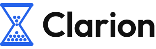
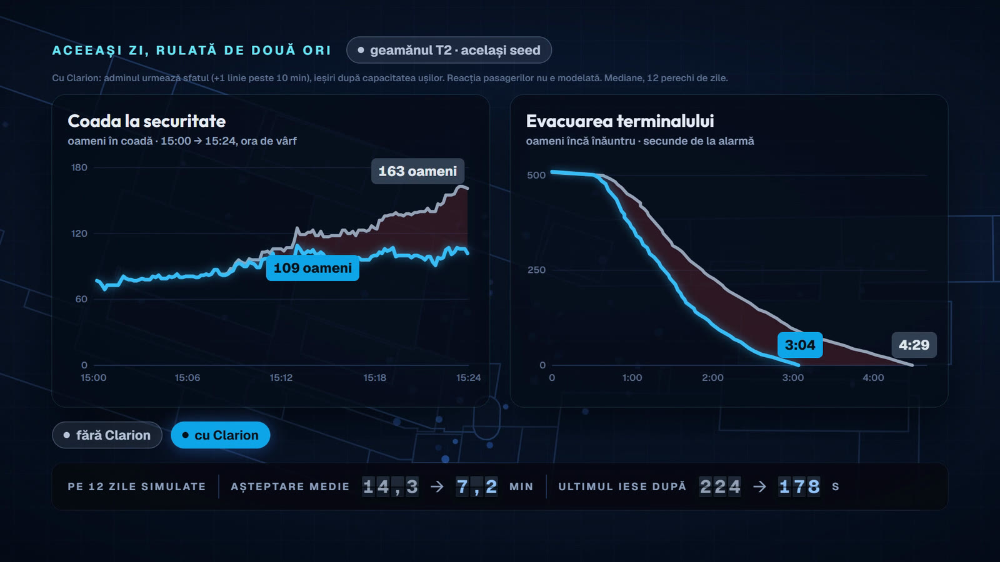
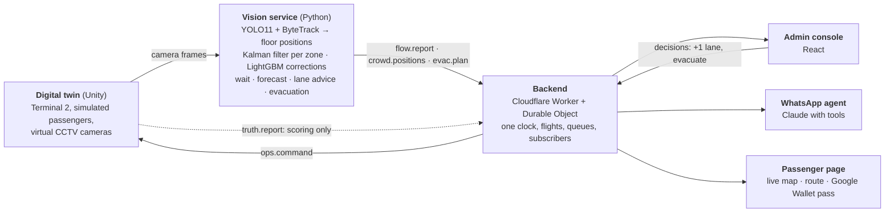
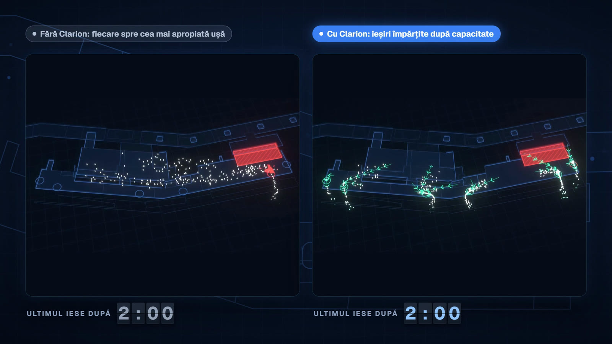
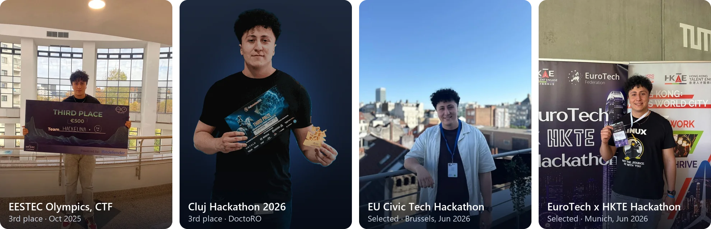

<p align="center">
  <picture>
    <source media="(prefers-color-scheme: dark)" srcset="docs/media/clarion-lockup-dark.svg">
    
  </picture>
</p>

<p align="center">
  <b>The airport, clear.</b><br>
  Crowd control for Craiova Airport, built in one weekend at Craiova Hackathon 2026 (CONTROL TOWER challenge).
</p>

<p align="center">
  <a href="https://github.com/Marius0G/clarion/actions/workflows/ci.yml"></a>
  <a href="#how-it-was-built"></a>
  <a href="https://github.com/Marius0G/clarion/releases/latest"></a>
  <a href="https://clarion-craiova.pages.dev"></a>
  
</p>

<p align="center">
  <a href="https://marius0g.github.io/clarion/"></a>
</p>
<p align="center">
  <a href="https://marius0g.github.io/clarion/"><b>▶ Watch the 3-minute film</b></a> (sound on: Romanian voice, English subtitles)
  · <a href="https://github.com/Marius0G/clarion/releases/latest">download it</a>
</p>
<p align="center">
  <a href="#clarion-in-30-seconds">Overview</a> ·
  <a href="#what-it-looks-like">Screens</a> ·
  <a href="#how-it-works">How it works</a> ·
  <a href="#results">Results</a> ·
  <a href="#try-it">Try it</a> ·
  <a href="#team">Team</a> ·
  <a href="#track-record">Track record</a>
</p>

---

## Clarion in 30 seconds

You never know how early to leave for the airport. The airport, meanwhile, has cameras everywhere, and nobody tells you what they see. Clarion does:

- **The cameras count.** Every queue in the terminal, in people and in minutes, now and 30 to 120 minutes ahead. No faces, no names: only counts, flows and anonymous dots on a map.
- **Passengers get it on WhatsApp.** Scan the boarding pass (or add the Google Wallet pass) and send one message. From then on: check-in, security and the walk to the gate at the time you will get there, the delay the second it happens, and answers to any question about the airport.
- **The admin sees it on one screen.** The terminal map, every queue, and advice such as *"open one more lane by 15:15"*, with one click to act and the effect measured afterwards.
- **Staff report in plain words.** *"Abandoned bag near check-in 2"* becomes a pin on the map, and the response team sees how soon it gets there.
- **In a crisis, everyone gets their own way out.** The admin evacuates a zone and every passenger gets the route to the nearest *free* exit, not the one everybody takes.

We tested it on a digital twin of Craiova's Terminal 2, in which every simulated passenger has a story and decides for themselves. **The same day, run twice, with and without Clarion** (12 days, same seed for both arms):

| | Without Clarion | With Clarion |
|---|---:|---:|
| Average wait at security | 14.3 min | **7.2 min** |
| 90th-percentile wait at security | 31.0 min | **12.3 min** |
| Evacuation: last person out | 224 s | **178 s** |

How we measured it, and what these numbers do *not* show, is under [Results](#results).

## What it looks like

<table>
  <tr>
    <td width="50%"></td>
    <td width="50%"></td>
  </tr>
  <tr>
    <td><b>Passenger.</b> One WhatsApp thread, linked to the flight. It describes the situation and how it may change, and leaves the decision to the passenger.</td>
    <td><b>Admin.</b> One screen in the style of a control room (ISA-101): zones coloured by rule, the forecast, the advice and the button that acts on it.</td>
  </tr>
  <tr>
    <td></td>
    <td></td>
  </tr>
  <tr>
    <td><b>Cameras.</b> Clarion only sees through the cameras the airport already has: people are detected, their feet become points on the floor plan, and every zone gets a count.</td>
    <td><b>The digital twin.</b> A Unity replica of Terminal 2, where each simulated passenger weighs their own plans. It is the test environment, never an input.</td>
  </tr>
</table>

<p align="center"></p>

## How it works



**One rule shaped the whole design: Clarion sees only through the cameras.** Its inputs are the camera images, the flight schedule and the admin's decisions, exactly what a real airport has. The twin knows the exact truth (every queue, every wait), but that truth travels on a separate channel used only to score the estimates and to run the A/B test. It never reaches a decision, a route or a message.

### The algorithms

| | Step | How |
|---|---|---|
| A1 | People detection | YOLO11s and ByteTrack on every camera. The foot point of each box goes through the lens correction and the camera's image-to-floor homography and becomes a position on the floor, in metres. |
| A2 | Count correction | People hide each other in a dense queue. A LightGBM model per zone and camera turns detections, coverage, density and box size into the real count, trained on simulated days where the truth is known. |
| A3 | Count and flow per zone | A Kalman filter per zone: the prediction adds the people entering and removes those leaving the head of the queue, the update trusts the corrected count as much as the camera coverage allows. A dead camera degrades gracefully to "unknown". |
| A4 | Wait now | People in the queue ÷ (service rate per lane × open lanes), with the rate measured at the queue head over the last 5 minutes, a learned correction, and a 90th percentile from the filter's uncertainty. |
| A5 | Forecast, +30 to +120 min | Arrivals from the flight schedule × a lognormal show-up curve per flight, rescaled live by what the cameras see; a fluid queue model; delayed flights shift their curve; a learned correction per horizon. |
| A6 | When to arrive | Gate close − (check-in + security at the times you will reach them + walk + margin), solved by iteration, per passenger. |
| A7 | Lane advice | The fewest lanes that keep the forecast under target (10 min at security, 15 at check-in) for the next hour, and the time by which to open them. |
| A8 | Walking times | Weidmann's fundamental diagram (speed falls with density) on the terminal graph: routes to gates and the response team's ETA. |
| A9 | Evacuation time | Time-expanded max-flow over the terminal graph in 5 s steps, doors at 1.3 people per second per metre of width (SFPE), with staggered reaction times. |
| A10 | Evacuation routes | The same flow splits each zone across the exits so no door is overloaded; blocked zones leave the graph; it re-plans in about a second. |
| A11 | Training | Dozens of three-hour peaks simulated with different seeds (schedule, load, lanes, delays, evacuations); seeds held out of training give the accuracy figures below. |

The full design, decision by decision (D0 to D34), is the team spec [`docs/SPEC-v2.md`](docs/SPEC-v2.md). The messages between the twin, the vision service and the backend are a frozen contract in [`docs/contract/`](docs/contract/), which let the three of us build in parallel from the first night.

### Built with

| Part | Stack |
|---|---|
| Vision service |       |
| Backend |     |
| Console and passenger app |   |
| Digital twin |  |
| Passenger channels |    |
| Tests and CI |     |

## Results

**The A/B test** ([`docs/d19-ab.md`](docs/d19-ab.md)): 12 seeds in the `rush` scenario (×2.5 load, 2 security lanes at the start). The same seed means the same day and the same passengers in both arms; figures are medians over the pairs.

| | A: without Clarion | B: with Clarion | B − A |
|---|---:|---:|---:|
| Security wait, average (3-hour windows) | 14.3 min | 7.2 min | −6.6 min |
| Security wait, 90th percentile | 31.0 min | 12.3 min | −16.5 min |
| Evacuation: half out (t50) | 97 s | 79 s | −22.5 s |
| Evacuation: 90 % out (t90) | 190 s | 149.5 s | −54.5 s |
| Evacuation: last person out | 223.5 s | 177.5 s | −58.5 s |

What B means, exactly: a simple local rule stands in for the vision service's advice and the admin follows it (one more lane when the wait passes 10 minutes, one fewer under 3, a lane takes 5 simulated minutes to open), and evacuees are split across exits by door capacity. In A, the planned lanes stay all day and everyone leaves by the nearest door. **How passengers react to Clarion's messages is not modelled**, so the passenger side of the benefit is not in these numbers.

<p align="center"><br>
<sub>The same evacuation in the twin. Left: everyone heads for the nearest door. Right: Clarion splits people across the exits by capacity.</sub></p>

**How well the cameras see** ([`vision/RESULTS.md`](vision/RESULTS.md)), on seeds held out of training, `rush` scenario:

| Queue | People in it, on average | Count error, raw → Clarion | Wait error, physics only → Clarion |
|---|---:|---:|---:|
| Security | 69 | 33.4 → **6.0 people** | 3.8 → **2.9 min** |
| Check-in, group 1 | 20 | 5.5 → **2.8 people** | 2.0 → **1.6 min** |

The evacuation plan, computed live from the cameras in 0.5 to 1.1 s, was within 26 s of the simulated last person out (21 s for t90) when people followed its split.

What does not work yet, in the team's own words: the security forecast is still 8 to 10 minutes off; above 60 people in the queue the wait error grows to about 4.5 minutes; the demo ran on the twin's simulated detector, which is more optimistic than real YOLO11 (YOLO found 41 % of the labelled people on the twin's cameras); and every figure comes from simulation, not from a real terminal.

## Try it

**Live:** the deployment from the event is still up at [clarion-craiova.pages.dev](https://clarion-craiova.pages.dev): the landing page, the [admin console](https://clarion-craiova.pages.dev/console) and the [passenger sign-up](https://clarion-craiova.pages.dev/join). The twin and the vision service are not running now, so the console shows the terminal without live data; the film shows it running. WhatsApp uses a Meta test number that only messages numbers registered with it, so it cannot be tried from outside the team.

**Locally** (Node 22.12 or newer), in three terminals:

```sh
(cd backend && npm ci && npm run dev)       # the backend, on http://localhost:8787
(cd app && npm ci && npm run dev)           # the console, on http://localhost:5173
(cd backend && npm run demo:terminal)       # a stand-in for the twin, so the console has data
```

Without credentials, WhatsApp, Wallet and the language model run in dry-run or deterministic mode. Configuration: [`backend/README.md`](backend/README.md) and [`worker/README.md`](worker/README.md). The vision service has its own guide in [`vision/README.md`](vision/README.md); its tests run without the twin:

```sh
cd vision && pip install numpy scipy httpx websockets lightgbm opencv-python pytest && python -m pytest -q
```

## Inside the repository

| Folder | What is in it |
|---|---|
| [`app/`](app/) | React + Vite: the landing page, the admin console, passenger sign-up with boarding-pass scanning, the passenger's live map and route, the staff page, and 2,541 pre-rendered route maps that WhatsApp sends as pictures |
| [`worker/`](worker/) | The backend on Cloudflare: a Worker and a Durable Object that holds the one clock, the flights, the queues and the subscribers; the WhatsApp agent (Claude with tools, a deterministic fallback without a key); Google Wallet boarding passes |
| [`backend/`](backend/) | The same engine as a Node server, for local runs and tests |
| [`vision/`](vision/) | The vision service in Python: cameras → queues → waits → forecast → advice → evacuation (A1 to A11), the trained models and the measured results |
| [`docs/`](docs/) | The team spec, the contract between the twin, vision and the backend, the map of Terminal 2 (zones, points, floors), the A/B results and the integration audit |
| [`whatsapp/`](whatsapp/) | The WhatsApp message templates |

Not here: the Unity digital twin, which stays private because it is built on third-party imagery we cannot redistribute, and the film's project files.

## How it was built

- **One weekend.** The first commit landed on 30 October at 23:33 and the last on 1 November at 14:55, five minutes before the code freeze. Everything above was written during the event, apart from the WhatsApp and login layers, which Bogdan ported from his earlier project [Moni](https://joinmoni.tech).
- **300 commits and 801 automated tests** that run in CI on every push (202 backend, 359 Worker, 146 app, 94 vision), plus Playwright end-to-end specs for the browser flows. The Worker's tests run in `workerd`, the same runtime as production.
- **Contract first.** The twin, the vision service and the backend agreed on their messages on the first night, then each side was built and tested against the contract on its own.
- **With AI agents.** We wrote the spec, the contracts and the briefs; AI coding agents (Claude Code and Codex) wrote much of the code on parallel branches, each change checked by tests before it reached `main`.

## Team

<table>
  <tr>
    <td align="center" valign="top" width="25%"><a href="https://github.com/Marius0G"><br><b>Marius Manea</b></a><br><sub>The algorithms (camera vision, queues, waits, forecast, evacuation, the ML), the digital twin as the test environment, the A/B and accuracy evaluation, and the film</sub></td>
    <td align="center" valign="top" width="25%"><a href="https://github.com/Bogdan-ca"><br><b>Bogdan Caraeane</b></a><br><sub>The backend (Cloudflare Worker and Durable Object), the admin console, the WhatsApp agent, Google Wallet and login</sub></td>
    <td align="center" valign="top" width="25%"><a href="https://github.com/dianaistrate"><br><b>Diana Istrate</b></a><br><sub>Business and the pitch</sub></td>
    <td align="center" valign="top" width="25%"><a href="https://github.com/bristiana"><br><b>Cristiana Constantin</b></a><br><sub>Built with us on the first day of the event</sub></td>
  </tr>
</table>

### Track record

Between us: nine results at hackathons and competitions in Romania since 2025, with four first places, Adobe's Best Innovation Prize, a second place and three thirds.

| | Result | What we built | When |
|:-:|---|---|---|
| 🏆 | **Best Innovation Prize (Adobe)**<br>SmartHack 2026, team of five | **Pandora**: a home network check that finds open ports, explains each risk in plain language and proves every fix with a re-scan, plus a 3D-printed ESP32 box | Nov 2026 |
| 🥇 | **1st, Stripe challenge**<br>NEXXT AI Hackathon 2026, 60+ teams | **[Moni](https://joinmoni.tech)**: an AI money companion that reads real bank accounts and talks to you on WhatsApp, with a browser extension that shows at checkout what a purchase means for your savings goal | Oct 2026 |
| 🥇 | **1st, Procter & Gamble challenge**<br>Hackitall II, team of three | Procurement intelligence for sourcing buyers: supplier data and risk signals from unstructured public data, with verifiable evidence for every insight, built in 24 hours. [Post](https://www.linkedin.com/feed/update/urn:li:activity:7446908357283704833/) | Apr 2026 |
| 🥇 | **1st, Veridion challenge**<br>VibeHack | A company ranking and qualification system that decides whether a company truly matches a request, tested on 12 queries with a focus on algorithmic efficiency | Mar 2026 |
| 🥇 | **1st, AI for Human Benefit**<br>Best Engineering Marathon (BEST Bucharest), team of four | A human-centric AI prototype for a social challenge. [Post](https://www.linkedin.com/feed/update/urn:li:activity:7406114078751903744/) | Dec 2025 |
| 🥈 | **2nd**<br>Innovation Labs AI Validation Bootcamp (ITFest), team of two | **Lore**: watches Teams and Slack, spots when daily practice drifts from the company's documents and proposes the edit, with the evidence. On a public company handbook's real history, 24 of the 25 pages it flagged were later corrected by the company itself, after a median of 263 days. It earned a place at the Innovation Labs hackathon | Oct 2026 |
| 🥉 | **3rd**<br>Cluj Hackathon 2026 | **DoctoRO**: transcribes the consultation live and writes the structured consultation sheet, with QR-based record ownership for patients. Our second podium in a row at Romania's largest hackathon | May 2026 |
| 🥉 | **3rd, Capture the Flag**<br>EESTEC Olympics, 13th edition | Team Hackelina, among teams hand-picked by Bitdefender: 20+ hours of exploiting and patching real vulnerabilities. [Post](https://www.linkedin.com/posts/mariusmanea05_eestecolympics-bitdefender-ctf-activity-7388307980435406850-XIWT) | Oct 2025 |
| 🥉 | **3rd**<br>Cluj Hackathon 2025 | **AngelAI**: a voice assistant for real-time emergency guidance on web and Android, covering 30+ countries. [Post](https://www.linkedin.com/posts/mariusmanea05_ai-hackathon-clujhackathon-activity-7333501174135799809-lNE_) | May 2025 |

We were also selected for two international hackathons in June 2026: the EU Civic Tech Hackathon in Brussels, with [EU Youth Buddy](https://github.com/Marius0G/CivicTech), and the EuroTech x HKTE Hackathon in Munich, with [SkyObs](https://github.com/Mosquito-Control/skyobs).

<p align="center"></p>

## Privacy

- The cameras produce counts, flows and anonymous dots on the map. No face recognition, and nobody is followed from one camera to the next.
- Passengers opt in. The boarding pass is decoded in the browser; the image never reaches the backend.
- No phone numbers, personal screenshots or secrets in this repository. Credentials live in Cloudflare and in local `.env` files.

## Credits

- Map data © [OpenStreetMap](https://www.openstreetmap.org/copyright) contributors (ODbL 1.0); passenger statistics from Eurostat.
- [Ultralytics YOLO11](https://github.com/ultralytics/ultralytics) (AGPL-3.0), ByteTrack, [LightGBM](https://github.com/microsoft/LightGBM) (MIT) and the libraries in each `package.json` and `requirements.txt`.
- The film's music and sound effects were made in code for it. The digital twin's third-party assets are listed in [`docs/CREDITS.md`](docs/CREDITS.md).

There is no license file yet: the code is public so it can be read and reviewed. Ask us before reusing it.

---

<details>
<summary><b>Pe scurt, în română</b></summary>

Clarion e un sistem de crowd control pentru Aeroportul Craiova, construit într-un weekend la Craiova Hackathon 2026 (provocarea CONTROL TOWER). Camerele pe care aeroportul le are deja numără oamenii din fiecare coadă, fără fețe și fără nume. Pasagerii primesc pe WhatsApp cât se așteaptă acum și peste o oră, iar adminul vede pe un singur ecran unde trebuie deschisă încă o linie. La o evacuare, fiecare pasager primește drumul spre cea mai apropiată ieșire liberă.

L-am testat pe un geamăn digital al terminalului T2, în care fiecare om ia singur decizii. Pe 12 zile simulate, rulate de două ori, cu și fără Clarion, așteptarea medie la securitate a scăzut de la 14,3 la 7,2 minute, iar la evacuare ultimul om a ieșit după 178 de secunde în loc de 224. Specul echipei e în [`docs/SPEC-v2.md`](docs/SPEC-v2.md), iar cifrele măsurate și limitele lor, în [`vision/RESULTS.md`](vision/RESULTS.md).

Echipa: Marius Manea, Bogdan Caraeane și Diana Istrate. Între noi, nouă rezultate la hackathoane și competiții din România din 2025 încoace: patru locuri I, Best Innovation Prize de la Adobe, un loc II și trei locuri III. Lista completă e mai sus, la [Track record](#track-record).

</details>
